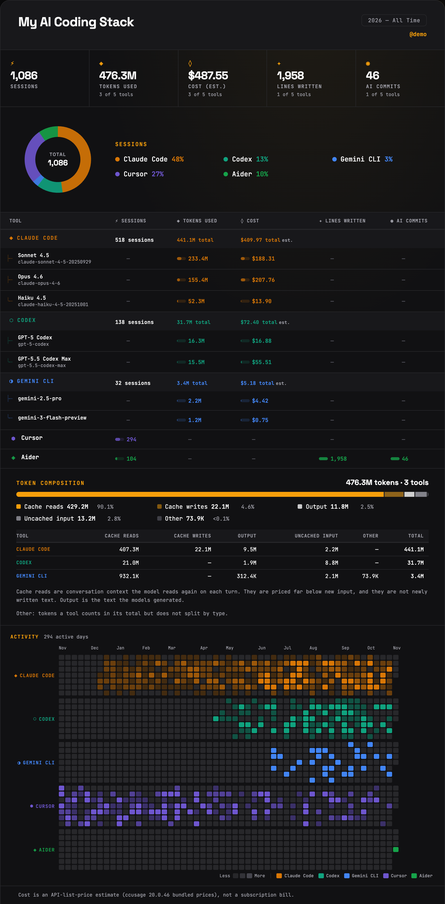

<p align="center">
  
</p>

<h1 align="center">stackpulse</h1>

<p align="center">
  <strong>Generate beautiful, shareable cards for your AI coding tool usage</strong>
</p>

<p align="center">
  <a href="https://www.npmjs.com/package/stackpulse"></a>
  <a href="https://github.com/KrishnaSathvik/stackpulse/blob/main/LICENSE"></a>
  
  
</p>

<p align="center">
  <a href="#quick-start">Quick Start</a> •
  <a href="#supported-tools">Supported Tools</a> •
  <a href="#themes">Themes</a> •
  <a href="#config-file">Config File</a> •
  <a href="#how-it-works">How It Works</a>
</p>

---

## What is stackpulse?

**stackpulse** scans your machine for AI coding tools, reads their local usage data (sessions, tokens, cost), and generates a shareable HTML card with:

- Per-tool usage breakdown with model details
- Donut chart with smart metric selection
- GitHub-style activity heatmap (per-tool rows)
- Save as PDF (browser print) or share on X from the card itself

One command. No API keys. No data leaves your machine.

```bash
npx stackpulse
```

<p align="center">
  
</p>

---

## Quick Start

```bash
# Run directly (no install needed)
npx stackpulse

# Or install globally
npm install -g stackpulse
stackpulse
```

The interactive wizard walks you through 3 steps:

1. **Select tools** — auto-detected from your machine + manual entry
2. **Choose metrics** — sessions, tokens, cost, commits, lines written
3. **Customize** — title, handle, theme, output filename

Output: `stackpulse.html` (open in a browser; use "Save as PDF" or your browser's screenshot tool for an image)

---

## Supported Tools

stackpulse supports **13 AI coding tools**. Each tool has exactly one data source per scan, so
nothing is counted twice.

### Via the bundled collector (sessions + tokens + cost + models + heatmap)

All of these come from **one** offline run of the pinned [`ccusage`](https://github.com/ccusage/ccusage)
collector, installed with stackpulse — nothing is downloaded during a scan.

| Tool | Reads | Cost |
|---|---|---|
| **Claude Code** | `~/.claude/projects` (or `CLAUDE_CONFIG_DIR`) | estimated |
| **OpenAI Codex** | `~/.codex/sessions` (or `CODEX_HOME`) | estimated |
| **OpenCode** | `~/.local/share/opencode` | estimated |
| **Amp** | `~/.local/share/amp` | estimated |
| **Pi Agent** | `~/.pi/agent/sessions` | estimated |
| **Gemini CLI** | `~/.gemini/tmp/*/chats` (`.json` and `.jsonl`) | estimated |
| **Qwen Code** | `~/.qwen/projects/*/chats/*.jsonl` | estimated |
| **Kimi CLI / Kimi Code** | `~/.kimi` and `~/.kimi-code` `wire.jsonl` | estimated |
| **Antigravity** | `~/.gemini/antigravity*/conversations/*.db` | estimated |
| **Kilo Code** | Kilo CLI database `~/.local/share/kilo/kilo.db` | **recorded** by Kilo |

- **Estimated** costs use the collector's bundled API list prices. They are not your subscription bill.
- Usage that can't be priced is never shown as $0: a cost covering only part of the usage is marked `*` (a lower bound), and a model with no known price is named in the footnote.
- **Your `ccusage.json` is intentionally ignored.** ccusage normally merges `.ccusage/ccusage.json`
  (current folder) and `~/.claude/ccusage.json`; stackpulse always passes its own empty config, so
  your `since`/`until`, project filters, timezone and `pricingOverrides` there don't change stackpulse's
  numbers. Data-location variables (`CLAUDE_CONFIG_DIR`, `CODEX_HOME`, `*_DATA_DIR`) still apply.
- **Incomplete sources are flagged.** If a source is only partly readable (e.g. a corrupt database),
  that tool is marked *incomplete* with the reason and its figures are lower bounds. If it can't be
  read at all, the scan shows an error instead of "no data".
- **Tokens are exact; session counts follow the collector.** Token totals count every distinct
  message once, and stackpulse's tests check them against hand-computed totals. A *session* is
  whatever the collector counts: for Claude Code, one log file. When a resumed session repeats
  earlier messages, those messages are credited to whichever file the collector reads first. A
  resume file that contains only repeated messages may or may not count as a session. Session
  counts can therefore be off by one per such file, while tokens and cost are unaffected.
- **Reformatted Claude logs:** ccusage skips Claude log lines written with spaced JSON
  (`"usage": {`). stackpulse warns when it finds such files — a best-effort check that samples the
  start of each log, so it can miss some cases.

### Native readers

| Tool | Reads | Data |
|---|---|---|
| **Cursor** | `state.vscdb` (composer data) | Sessions, daily activity. Cursor stores no tokens or cost locally. |
| **Roo Code** | Per-task `history_item.json` files, plus the older VS Code globalState history | Tasks, tokens, **recorded** cost, daily activity |
| **Aider** | `.aider.chat.history.md` + git history | Sessions, plus commits and lines that aider attributes to itself |

**Fallbacks** (used only when the collector finds nothing for that tool, never added on top):
- **Antigravity:** the IDE's session index (session counts only).
- **Kilo Code:** the legacy VS Code extension's task history. Current Kilo migrates that history into `kilo.db`.

Tools not installed on your machine can still be added manually during the wizard.

---

## Themes

7 built-in themes, selectable in the wizard or via `--theme`:

| Theme | Vibe |
|---|---|
| `dark` | Terminal noir (default) |
| `light` | Clean minimal |
| `cosmic` | Deep space blues |
| `forge` | Amber heat |
| `arctic` | Ice blue on white |
| `verdant` | Forest green |
| `neon` | Pink synthwave |

```bash
stackpulse --theme cosmic
```

---

## Config File

Skip the wizard entirely with a YAML or JSON config:

```bash
# Generate a starter config
stackpulse --init ai-usage.yaml

# Run from config
stackpulse --config ai-usage.yaml
```

Example `ai-usage.yaml`:

```yaml
title: My AI Coding Stack
timeframe: "2026 — All Time"
username: latentengineer_
theme: dark
metrics:
  - sessions
  - tokens_used
  - cost_usd
tools:
  claude_code:
    sessions: 312
    tokens_used: 23500
    cost_usd: 180
  codex:
    sessions: 88
    tokens_used: 605400
    cost_usd: 240
  cursor:
    sessions: 1971
  gemini:
    sessions: 200
    tokens_used: 8400
```

---

## CLI Options

```
Usage: stackpulse [options]

Options:
  -V, --version          output version number
  -c, --config <file>    load from YAML or JSON config file
  -o, --output <name>    output base filename (default: "stackpulse")
  --theme <theme>        override theme (dark|light|cosmic|forge|arctic|verdant|neon)
  --title <title>        override card title
  --timeframe <range>    override timeframe text
  --username <handle>    override handle
  --init [file]          scaffold a starter YAML config
  -h, --help             display help
```

---

## How It Works

stackpulse reads **only local data** — nothing is sent to any server.

```
┌─────────────────────────────────────────────────────┐
│                    Your Machine                      │
│                                                      │
│  ~/.claude  ~/.codex  ~/.gemini  ~/.qwen  ~/.kimi    │
│  ~/.pi  ~/.local/share/{opencode,amp,kilo}           │
│              ──→  pinned ccusage (one offline run)   │
│  Cursor / Roo Code state  ──→  read-only SQLite      │
│  .aider.chat.history.md + git  ──→  file + git log   │
│                                                      │
│         ↓ all local ↓                                │
│                                                      │
│  ┌─────────────────────────────────────────────┐     │
│  │              stackpulse.html                     │     │
│  │  ┌─────┬──────────────────────────────┐     │     │
│  │  │Donut│  Tool table with bars        │     │     │
│  │  │chart│  + model breakdown           │     │     │
│  │  └─────┴──────────────────────────────┘     │     │
│  │  ┌────────────────────────────────────┐     │     │
│  │  │  Per-tool activity heatmap         │     │     │
│  │  └────────────────────────────────────┘     │     │
│  │  [Save PDF] [Share on X]                    │     │
│  └─────────────────────────────────────────────┘     │
└─────────────────────────────────────────────────────┘
```

---

## Export Options

The generated HTML card includes built-in export buttons:

- **Save as PDF** — uses the browser's native print dialog
- **PNG** — not built in yet; a native PNG/SVG export is in development
- **Share on X** — pre-filled tweet with your tool stats

---

## Requirements

- **Node.js 20.12+** (Node 22.13+ recommended; 18 is not supported — it never ran stackpulse 3.x)
- **SQLite access** for Cursor, Roo Code and the Antigravity/Kilo fallbacks: built in on Node 22.5+, otherwise the `sqlite3` CLI on your PATH
- Memory: the collector holds your full history in memory — roughly twice the size of your AI tool logs
- Tools you want to track must be installed and have local usage data

---

## Privacy

stackpulse is fully offline. It:

- Reads only local files on your machine
- Never sends data to any server
- Never requires API keys or authentication
- The HTML output is a standalone file with no external dependencies (except Google Fonts)

---

## Contributing

Contributions welcome! Especially:

- **New tool parsers** — if you use an AI coding tool not listed above
- **Themes** — add new visual themes to `generator.js`
- **Bug reports** — especially from tools with untested data formats

```bash
git clone https://github.com/KrishnaSathvik/stackpulse.git
cd stackpulse
npm install
node index.js
```

---

## License

MIT © [Krishna Sathvik Mantripragada](https://github.com/KrishnaSathvik)

---

<p align="center">
  Built by <a href="https://x.com/latentengineer_">@latentengineer_</a> · 
  <a href="https://github.com/KrishnaSathvik/stackpulse">GitHub</a> · 
  <a href="https://www.npmjs.com/package/stackpulse">npm</a>
</p>
